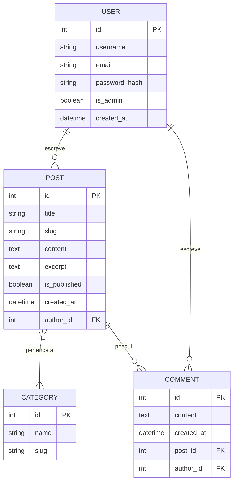

# 📗 Documentação Oficial do Projeto — Plataforma AENTECH

> **Science & Technology Portal**: Plataforma web integrada de computação científica, simulação molecular, quimioinformática e comunicação de pesquisa nas Ciências Químicas e Ciências da Vida.

---

## 📋 Sumário
1. [Visão Geral do Sistema](#-visão-geral-do-sistema)
2. [Arquitetura de Software & Tecnologias](#-arquitetura-de-software--tecnologias)
3. [Estrutura do Repositório](#-estrutura-do-repositório)
4. [Módulos & Funcionalidades Principais](#-módulos--funcionalidades-principais)
   - [Central de Química & Artigos](#1-central-de-química--artigos)
   - [Pesquisa STEM & Taxonomia Química](#2-pesquisa-stem--taxonomia-química)
   - [Sistema de Autenticação & Gestão](#3-sistema-de-autenticação--gestão)
5. [Modelos de Dados (Banco de Dados)](#-modelos-de-dados-banco-de-dados)
6. [Guia de Instalação e Execução](#-guia-de-instalação-e-execução)

---

## 🌐 Visão Geral do Sistema

A **Plataforma AENTECH** foi concebida para eliminar atritos entre a teoria químico-física avançada e a prática computacional. Ela consolida uma aplicação web em **Flask** que combina:
- **Disseminação Científica**: Blog de artigos, tutoriais interativos e central temática de Química com renderização em tempo real.
- **Mapeamento de Taxonomia STEM**: Visualizador interativo de pesquisas de fronteira em Físico-Química, Simulação Molecular e Quimioinformática.

---

## 🏗️ Arquitetura de Software & Tecnologias

- **Backend**: Python 3.11+ / Flask
- **ORM & Banco de Dados**: Flask-SQLAlchemy (driver SQLite3 em `instance/dev_app.db`)
- **Autenticação & Sessões**: Flask-Login + Flask-Bcrypt (Controle de Acesso Baseado em Funções - RBAC)
- **Frontend & UI**: HTML5 Semântico, Vanilla CSS3, Bootstrap 5.3, Bootstrap Icons

---

## 📁 Estrutura do Repositório

```text
sqlite-query/
├── app/
│   ├── __init__.py              # Inicializador da aplicação Flask e Blueprints
│   ├── config.py                # Configurações de ambiente (Dev / Prod)
│   ├── forms.py                 # Formulários Flask-WTF / WTForms
│   ├── models.py                # Modelos ORM (User, Post, Category, Comment, Tutorial)
│   ├── auth/                    # Blueprint de Autenticação
│   │   ├── forms.py             # Formulário de Login
│   │   ├── views.py             # Lógica de login, logout e controle de sessão
│   │   └── templates/auth/      # Interface de Login
│   ├── main/                    # Blueprint Principal
│   │   └── views.py             # Rotas do blog, ferramentas, survey e química
│   ├── static/                  # CSS, Imagens e Ativos
│   └── templates/               # Templates Jinja2
│       ├── base.html            # Layout mestre com sidebar e navegação
│       └── main/                # Templates de visualização (chemistry, survey, etc.)
├── instance/                    # Dados de instância
│   └── dev_app.db               # Banco de dados SQLite de desenvolvimento
├── requirements.txt             # Dependências Python do projeto
├── stem_survey_serialized_submission.json # Dados serializados da pesquisa STEM (100% Traduzidos)
├── config.py                    # Mapeamento de configurações globais
├── DOCUMENTACAO_OFICIAL.md      # Documentação oficial do projeto
└── README.md                    # Histórico de alterações e consolidação técnica
```

---

## ⚙️ Módulos & Funcionalidades Principais

### 1. Central de Química & Artigos
- **Rota**: `/chemistry`
- **Descrição**: Apresenta os fundamentos da química teórica, computacional e físico-química de fluidos.
- **Recursos**:
  - Cards de tópicos (Termodinâmica & Fluidos, Estrutura Eletrônica, Topologia & Similaridade).
  - Blocos informativos com sintaxe `//` no estilo pseudocódigo para transporte de fluidos, parâmetros moleculares, similaridade química e modelagem eletrônica.
  - Carrossel dinâmico das 3 publicações mais recentes vinculadas à categoria *Química*.

### 2. Pesquisa STEM & Taxonomia Química
- **Rota**: `/survey`
- **Fonte de Dados**: `stem_survey_serialized_submission.json`
- **Descrição**: Interface interativa que renderiza a pesquisa serializada sobre a taxonomia das Ciências Químicas (níveis L1 a L4).
- **Conteúdo Integrado**:
  - Visão geral de domínios (Físico-Química, Química Teórica e Computacional).
  - Fluxos de trabalho avançados (*Workflows*): Simulação de transporte em líquidos (Green-Kubo / RDF), Metadinâmica bem-temperada de polímeros (*PLUMED / GROMACS*) e Triagem Virtual em Quimioinformática (*RDKit / XGBoost*).
  - Subtarefas detalhadas com prompts operacionais otimizados e auditoria de desafios em LLMs.

### 3. Sistema de Autenticação & Gestão
- **Rotas**: `/login`, `/logout`, `/create`, `/edit/<id>`, `/delete/<id>`, `/categories`
- **Segurança**:
  - Senhas criptografadas via `Bcrypt`.
  - Decorador `@admin_required` garantindo restrição rígida de acesso a funcionalidades administrativas.
  - Ocultação condicional na UI (``).
- **Credenciais de Administrador Padrão (Ambiente Local)**:
  - **Usuário**: `aen`
  - **E-mail**: `aentech.info@gmail.com`
  - **Senha Padrão**: `admin123`

---

## 🗄️ Modelos de Dados (Banco de Dados)

O esquema é gerenciado via SQLAlchemy (`app/models.py`):



---

## 🚀 Guia de Instalação e Execução

### 1. Requisitos do Sistema
- Linux (Ubuntu 22.04/24.04 LTS ou similar) / macOS
- Python 3.11 ou superior

### 2. Passo a Passo de Instalação

```bash
# 1. Clonar ou navegar até o diretório do projeto
cd /caminho/para/sqlite-query

# 2. Ativar o ambiente virtual Python
source .venv/bin/activate

# 3. Instalar as dependências do projeto
pip install -r requirements.txt

# 4. Executar a aplicação em modo de desenvolvimento
flask run --host=0.0.0.0 --port=5000
```

Acesse a aplicação no navegador através de `http://localhost:5000`.

---

## 🧪 Testes Automatizados

A suíte de testes usa **pytest** e cobre o factory da aplicação, os modelos ORM, autenticação, views públicas, CRUD administrativo/permissões e o SEO dinâmico (meta tags, JSON-LD, `robots.txt` e `sitemap.xml`).

```bash
# 1. Instalar as dependências de desenvolvimento
pip install -r requirements-dev.txt

# 2. Executar a suíte completa
pytest

# 3. Executar com relatório de cobertura
pytest --cov=app --cov=config --cov-report=term-missing
```

Os testes usam uma configuração isolada (`config.TestingConfig`), com banco SQLite temporário e CSRF desabilitado, sem tocar nos dados de desenvolvimento.

```text
tests/
├── conftest.py            # Fixtures: app, banco, clientes e dados de exemplo
├── test_app_factory.py    # Factory, configuração e handlers de erro
├── test_models.py         # Modelos: User, Role, Post, Category, Comment, Tutorial
├── test_auth.py           # Login, logout e sessão
├── test_public_views.py   # Views públicas (blog, química, survey, tutoriais, busca)
├── test_admin_views.py    # CRUD administrativo e controle de acesso
├── test_seo.py            # SEO dinâmico: meta, Open Graph, JSON-LD, robots, sitemap
└── test_seo_helpers.py    # Funções utilitárias de SEO
```

---

*Documentação consolidada e atualizada oficialmente para a Plataforma AENTECH.*
